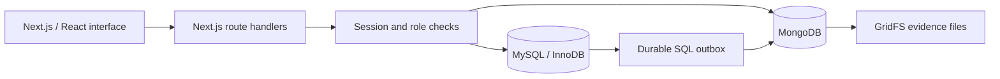
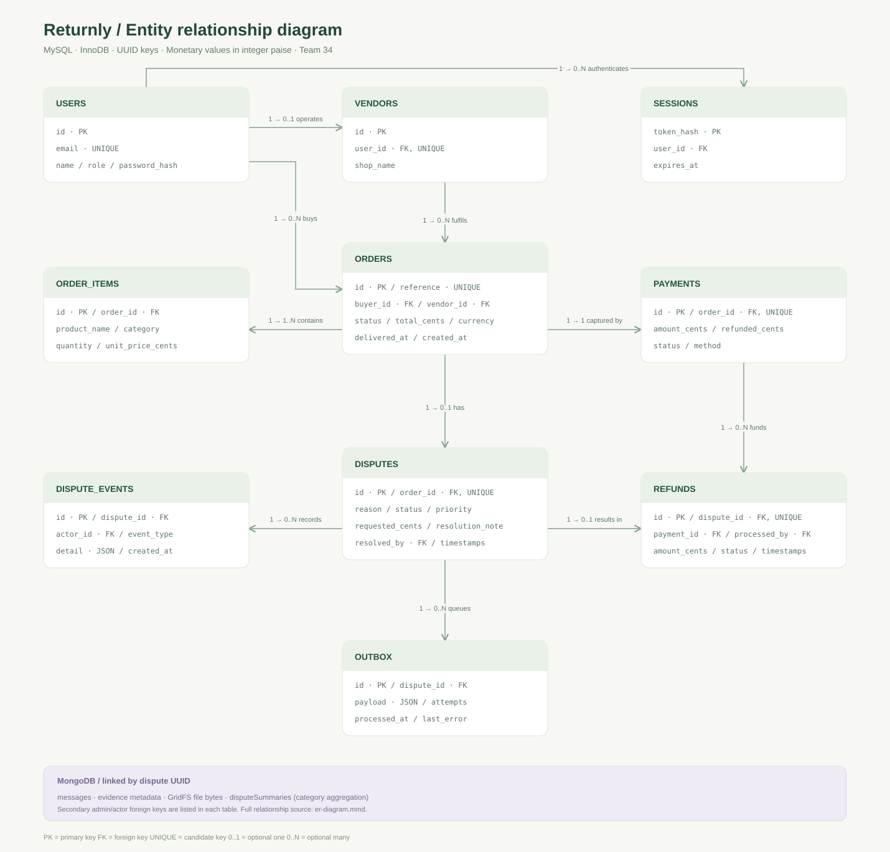

# Database design and project documentation

## Purpose and scope

Returnly manages the post-purchase dispute lifecycle: buyers raise a concern against an order, vendors provide their perspective, and admins record a reasoned decision. Payment capture is represented by seed data; approved refunds reserve captured funds and a separate simulator marks them completed. Shopping, checkout, shipment tracking, real payments, public registration and live chat are outside scope.

## Architecture



The API is the only path from the browser to either database. Credentials stay on the server. Read and write queries constrain records by the authenticated buyer ID or the vendor account associated with the order. Admins can see all project records.

## Entity relationship diagram



The editable Mermaid version is in `er-diagram.mmd`. A single order belongs to one buyer and one vendor, may contain multiple line items, has one captured payment, and can have zero or one dispute. A dispute can have zero or one approved refund and many audit events and outbox deliveries.

## Relational data dictionary

All tables use InnoDB. IDs are application-generated UUIDs; integer monetary values represent **paise**, avoiding floating-point arithmetic. Times are stored in UTC and formatted locally by the browser.

| Table               | Primary key / notable attributes                                                                                                          | Relationships and constraints                                                                                  |
| ------------------- | ----------------------------------------------------------------------------------------------------------------------------------------- | -------------------------------------------------------------------------------------------------------------- |
| `users`             | `id`, `name`, unique `email`, `password_hash`, role, created time                                                                         | Role is buyer/vendor/admin. Passwords use independently salted scrypt hashes.                                  |
| `vendors`           | `id`, unique `user_id`, `shop_name`                                                                                                       | One shop per vendor account; FK to users.                                                                      |
| `sessions`          | SHA-256 `token_hash`, `user_id`, `expires_at`                                                                                             | FK to users, expiry index. Browser holds a random opaque token.                                                |
| `login_attempts`    | SHA-256 `attempt_key`, attempts, window start                                                                                             | Persistent account-based rate-limit window.                                                                    |
| `orders`            | `id`, unique reference, buyer/vendor IDs, status, `total_cents`, currency, delivery/creation dates                                        | Buyer/vendor FKs; positive total. Buyer/time and vendor indexes.                                               |
| `order_items`       | `id`, `order_id`, product name/category, quantity, unit price                                                                             | Order FK; positive quantity and price. Captures the purchased product snapshot.                                |
| `payments`          | `id`, unique `order_id`, captured amount, refunded amount, status, method                                                                 | One payment per order. `0 <= refunded_cents <= amount_cents`.                                                  |
| `disputes`          | `id`, unique reference, unique `order_id`, reason, title/description, status, priority, requested amount, resolution note/admin and times | Order/admin FKs, positive request; status/time and reason indexes. One case per order, including closed cases. |
| `refunds`           | `id`, unique reference, unique `dispute_id`, payment, amount, status, admin and dates                                                     | One refund per dispute; payment/admin FKs; positive amount.                                                    |
| `dispute_events`    | `id`, dispute/actor IDs, event type, JSON detail, time                                                                                    | Append-only application audit history; dispute/time index.                                                     |
| `outbox`            | `id`, `dispute_id`, JSON payload, attempts, processed time, error, creation time                                                          | Dispute FK; pending-delivery index. Inserted within the same SQL transaction as the business change.           |
| `schema_migrations` | integer version, applied time                                                                                                             | Tracks installed schema revisions.                                                                             |

Additional invariants enforced by the service layer: the buyer owns the order; the requested amount does not exceed the order total; an admin decision never exceeds the buyer's request or the remaining captured payment; only admins can change priority or resolve cases; terminal cases cannot receive new messages or evidence.

Product snapshots and order totals represent the sale at order time. This project does not offer a catalog or order-edit endpoint. Totals are supplied consistently by the seed; SQL `CHECK` constraints cannot independently validate sums across the line-item table. Role membership across user/vendor/order rows is enforced by setup and the application rather than a cross-table `CHECK`.

## Normalization

The transactional tables follow third normal form for this scope:

1. **1NF:** UUIDs identify rows, scalar business values occupy individual columns, and repeating items, refunds and events have separate rows. Flexible audit payloads are explicitly JSON, rather than encoded relational lists.
2. **2NF:** each table uses a single-column key; all non-key business attributes depend on that row's key. An order's buyer details live in users, and shop details live in vendors.
3. **3NF:** vendor names are not repeated in disputes, payment details are not repeated in refunds, and participant names are joined when reading the dashboard.

Document author names are deliberate display snapshots. `orders.total_cents`, `payments.refunded_cents`, and MongoDB dispute summaries are deliberate operational denormalizations: the seed initializes totals, the refund transaction maintains the payment amount, and the durable outbox maintains category summaries. These choices are documented rather than claiming that every derived field is independently normalized.

## Refund transaction and concurrency

The application begins an explicit MySQL transaction, locks the dispute row with `SELECT ... FOR UPDATE`, verifies access and open state, and locks the payment. An approval then:

1. Validates an integer amount against the buyer's request and available captured funds.
2. Calls `calculate_refund(payment_id, requested_cents, @refund_amount)` on the **same connection**. The procedure validates availability and returns the full or partial amount.
3. Inserts a pending refund and reserves funds by updating `payments.refunded_cents` and the payment status.
4. Closes the dispute with the admin's written explanation.
5. Inserts an audit event and an outbox entry, then commits everything together.

Any exception rolls back all SQL mutations. Row locks serialize simultaneous admin decisions; the unique refund/dispute constraint is an additional safeguard. The second decision observes a terminal case and is rejected. A declined dispute records the decision and audit event without creating a refund or changing the payment.

`refunded_cents` means **reserved for an approved refund**, including pending simulated payouts. The payment's refunded status therefore reflects the approved financial position, while `refunds.status` describes payout progress. Completing the simulator updates the refund and audit event in a second SQL transaction and is idempotent.

## View and stored procedure

`admin_dispute_dashboard` joins disputes, orders, buyers, vendors and refunds, exposing case status, amounts and age in hours. The application applies role restrictions to this view before rendering it; the view itself is not a database security boundary.

`calculate_refund` is a server-side stored procedure with an OUT parameter and an SQLSTATE exception for invalid amounts. It computes/validates the amount but does not commit or own the refund transaction. Use `npm run db:setup` to install it: the schema file uses statement markers for the Node runner rather than MySQL CLI `DELIMITER` commands.

## MongoDB document design

| Collection                                    | Fields / purpose                                                                                            | Index                                         |
| --------------------------------------------- | ----------------------------------------------------------------------------------------------------------- | --------------------------------------------- |
| `messages`                                    | string `_id`, `disputeId`, author ID/name/role, body, ISO UTC timestamp                                     | `(disputeId, createdAt)`                      |
| `evidence`                                    | ObjectId `_id`, dispute ID, GridFS `fileId`, filename, MIME type, byte size, uploader ID/name, created time | `disputeId`                                   |
| `evidenceFiles.files`, `evidenceFiles.chunks` | GridFS file metadata and chunks                                                                             | GridFS driver creates its standard indexes    |
| `disputeSummaries`                            | SQL dispute UUID as `_id`, reason, status, buyer/vendor account IDs, creation time                          | `(buyerId, reason)`, `(vendorUserId, reason)` |

Uploads accept PNG, JPEG and PDF only, at most 5 MiB each and ten per case. The server checks file signatures and MIME agreement, sanitizes names, stores bytes in GridFS, and checks case access again on every download. Downloads use attachment disposition and `nosniff`.

### Category aggregation

The insights page uses MongoDB, rather than substituting a SQL `GROUP BY`:

```javascript
db.disputeSummaries.aggregate([
  { $match: { buyerId: 'authenticated-buyer-id' } }, // omitted for admin
  { $group: { _id: '$reason', count: { $sum: 1 } } },
  { $project: { _id: 0, reason: '$_id', count: 1 } },
  { $sort: { count: -1 } },
]);
```

### Consistency across two databases

MySQL and MongoDB do **not** share an ACID transaction. Financial data and audit events commit in MySQL first. Messages are commands in the SQL outbox; deterministic message UUIDs and MongoDB upserts make retries idempotent. Category delivery reads the current SQL row, avoiding replay of stale status snapshots. A MySQL advisory lock permits one sync worker per database. A crash before marking delivery complete is safe to retry.

Workspace reads and business writes retry pending deliveries; `npm run db:sync` provides an explicit retry command, in batches of 100. This is request-driven eventual consistency, not a continuously running background queue. Large backlogs need repeated sync calls. A visible pending count is included in the interface. Thread/evidence reads report an unavailable store rather than silently presenting empty records.

Evidence upload spans MongoDB and SQL and uses best-effort compensation if the SQL operation fails. A case row lock prevents concurrent closure during upload. A process crash between the two stores can leave an orphan file or metadata record; a production system would need reconciliation and stronger upload lifecycle tracking. It does not affect the atomic SQL refund flow.

## Access and session security

Random 256-bit tokens are stored in HttpOnly, SameSite=Lax cookies; only token hashes are stored in SQL. Sessions expire after eight hours. The server resolves role and shop from the database, never from submitted UI state. Mutations require a matching `Origin` header and `APP_URL`; prepared statements bind SQL values. Uploads are private and all financial mutations require the admin role. Ten failed sign-ins per email window are allowed before a 15-minute limit applies. Use HTTPS and `SESSION_SECURE=true` if deploying beyond localhost.

## Implementation references

- Next.js route handlers and async cookies: https://nextjs.org/docs/app/api-reference/file-conventions/route and https://nextjs.org/docs/app/api-reference/functions/cookies
- MySQL locking reads: https://dev.mysql.com/doc/refman/8.4/en/innodb-locking-reads.html
- MongoDB GridFS: https://www.mongodb.com/docs/drivers/node/current/crud/gridfs/
